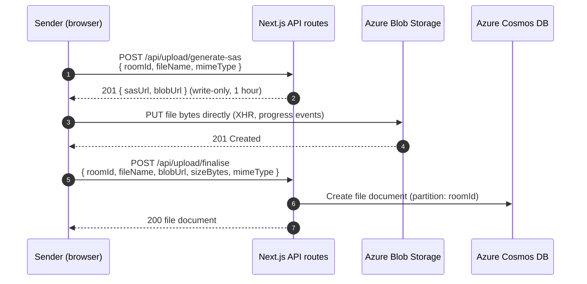
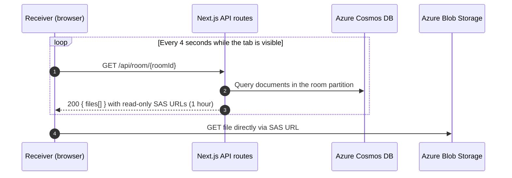

# BridgeDrop

**Cross-device file sharing through short-lived rooms, built on Next.js and Microsoft Azure.**

A sender creates a room, shares a six-character code or QR code, and uploads files. A receiver joins the room from any device and downloads them. File bytes travel directly between the browser and Azure Blob Storage; the application server only issues short-lived access tokens and records metadata.

[](https://github.com/CodeAbbas/BridgeDrop/actions/workflows/main.yml)


---

## Table of contents

- [Overview](#overview)
- [Features](#features)
- [Architecture](#architecture)
- [Technology stack](#technology-stack)
- [Project structure](#project-structure)
- [Getting started](#getting-started)
- [Environment variables](#environment-variables)
- [Infrastructure (Terraform)](#infrastructure-terraform)
- [API reference](#api-reference)
- [Data model](#data-model)
- [Security model](#security-model)
- [Observability](#observability)
- [Docker](#docker)
- [CI/CD](#cicd)
- [Legacy mode (iOS 12 and earlier)](#legacy-mode-ios-12-and-earlier)
- [Known limitations](#known-limitations)
- [Roadmap](#roadmap)
- [Author](#author)

---

## Overview

BridgeDrop solves a narrow, common problem: moving files between two devices that do not share an ecosystem, without accounts, cables or installed apps.

The project began as a peer-to-peer tool using WebRTC data channels with Firebase for signalling. It was later re-architected as a cloud-native application on Azure. The current design uses the **Valet Key pattern**: the server never handles file contents. Instead, it mints a narrowly scoped Shared Access Signature (SAS) for each file, and the browser uploads to and downloads from Blob Storage directly. This keeps the server stateless and lightweight, and removes it as a bottleneck for large transfers.

## Features

**Sharing**

- Room-based sharing with a six-character code; no sign-up required
- QR code generated for every room, with deep-link auto-join (`/?room=ABC123`)
- Receiver can join by typing the code or scanning the QR code with the device camera
- Multi-file upload in a single batch

**Transfer experience**

- Byte-level upload progress, per file and across the whole batch (weighted by size)
- Upload cancellation at any point via `AbortController`
- Receiver file list refreshes automatically every four seconds, and pauses while the tab is hidden
- Downloads save with the original filename, including non-ASCII names (RFC 5987 `Content-Disposition`)

**File management**

- Inline previews for images, video and audio; type-specific icons for PDFs, text, archives and office documents
- Sender can rename and delete files, with optimistic UI updates that roll back on failure
- Two-step confirmation before deletion

**Platform**

- Responsive glass-style interface built with Tailwind CSS 4
- Infrastructure defined as code with Terraform
- Containerised with a multi-stage Docker build
- GitHub Actions pipeline for linting and image publishing
- Client-side telemetry with Azure Application Insights
- Dedicated fallback experience for iOS 12 and earlier

## Architecture

### Upload flow (Valet Key pattern)



### Download flow



### Design decisions

| Decision | Rationale |
| --- | --- |
| Direct-to-Blob uploads with SAS tokens | File bytes never pass through the Next.js server, so memory use and request duration stay constant regardless of file size. |
| One Cosmos DB document per file, partitioned by `roomId` | Listing a room is a single-partition query. Rename and delete are point operations on `(id, roomId)`. |
| Clean blob URLs stored; SAS tokens minted on read | No credential is ever persisted. Each room fetch issues fresh one-hour read tokens. |
| `XMLHttpRequest` for uploads | `fetch` has no upload progress event with universal browser support. XHR is isolated in `src/lib/uploadWithProgress.ts` and exposes a promise-based, abortable API. |
| Lazy Azure client initialisation | Environment variables are read on the first request, not at module load, so `next build` succeeds in CI without secrets. |
| Polling instead of WebSockets | Keeps the application stateless and deployable to any container host. Polling pauses when the tab is hidden to limit request volume. |

## Technology stack

| Layer | Technology |
| --- | --- |
| Framework | Next.js 16 (App Router, standalone output), React 19, TypeScript 5 |
| Styling | Tailwind CSS 4, Lucide icons |
| Storage | Azure Blob Storage (`@azure/storage-blob`) |
| Database | Azure Cosmos DB for NoSQL, serverless (`@azure/cosmos`) |
| Observability | Azure Application Insights (web and React SDKs) |
| QR codes | `qrcode.react` (generation), `html5-qrcode` (camera scanning) |
| Infrastructure | Terraform (`azurerm` ~> 4.0) |
| Delivery | Docker (Node 20 Alpine), GitHub Actions, GitHub Container Registry |

## Project structure

```
BridgeDrop/
├── .github/workflows/main.yml     # Lint, then build and publish the Docker image
├── terraform/                     # Azure infrastructure as code
│   ├── main.tf                    #   Providers, resource group, naming
│   ├── storage.tf                 #   Storage account, CORS, private media container
│   ├── cosmosdb.tf                #   Cosmos account, database, room-metadata container
│   ├── variables.tf               #   Region, replication, TTL, CORS origins
│   └── outputs.tf                 #   Endpoints and (sensitive) keys
├── src/
│   ├── app/
│   │   ├── page.tsx               # Main entry point
│   │   ├── layout.tsx             # Root layout and fonts
│   │   ├── legacy/page.tsx        # Fallback for iOS 12 and earlier
│   │   └── api/
│   │       ├── upload/generate-sas/route.ts   # POST: mint write-only SAS
│   │       ├── upload/finalise/route.ts       # POST: persist file metadata
│   │       ├── room/[roomId]/route.ts         # GET: list files with read SAS
│   │       └── file/[id]/route.ts             # PATCH: rename, DELETE: remove
│   ├── components/
│   │   ├── BridgeDrop.tsx         # Application shell, room and transfer logic
│   │   └── FileCard.tsx           # File tile: preview, rename, delete, download
│   └── lib/
│       ├── azure.ts               # Lazy, cached Cosmos and Blob clients
│       ├── uploadWithProgress.ts  # Abortable XHR upload with progress
│       └── appInsights.ts         # Telemetry client with a no-op fallback
├── middleware.ts                  # Redirects legacy iOS devices to /legacy
├── Dockerfile                     # Multi-stage production image
└── next.config.ts                 # Standalone output
```

## Getting started

### Prerequisites

- Node.js 20 or later, and npm
- An Azure subscription
- [Terraform](https://developer.hashicorp.com/terraform/install) 1.5 or later
- [Azure CLI](https://learn.microsoft.com/cli/azure/install-azure-cli), signed in with `az login`

### 1. Clone and install

```bash
git clone https://github.com/CodeAbbas/BridgeDrop.git
cd BridgeDrop
npm install
```

### 2. Provision the Azure resources

```bash
cd terraform
terraform init
terraform apply
cd ..
```

See [Infrastructure (Terraform)](#infrastructure-terraform) for the resources created and the available variables.

### 3. Configure the environment

Create a `.env.local` file in the project root:

```bash
AZURE_STORAGE_CONNECTION_STRING="DefaultEndpointsProtocol=https;AccountName=...;AccountKey=...;EndpointSuffix=core.windows.net"
AZURE_COSMOS_ENDPOINT="https://<account>.documents.azure.com:443/"
AZURE_COSMOS_KEY="<primary-key>"

# Optional: enables telemetry
NEXT_PUBLIC_APPINSIGHTS_CONNECTION_STRING="InstrumentationKey=...;IngestionEndpoint=..."
```

The values can be retrieved after `terraform apply`:

```bash
# Cosmos DB
terraform -chdir=terraform output -raw cosmosdb_endpoint
terraform -chdir=terraform output -raw cosmosdb_primary_key

# Storage connection string
az storage account show-connection-string \
  --name "$(terraform -chdir=terraform output -raw storage_account_name)" \
  --resource-group "$(terraform -chdir=terraform output -raw resource_group_name)" \
  --query connectionString --output tsv
```

### 4. Run the application

```bash
npm run dev
```

Open [http://localhost:3000](http://localhost:3000). Choose **Send** in one browser window and **Receive** in another to test a transfer end to end.

### Scripts

| Command | Description |
| --- | --- |
| `npm run dev` | Start the development server |
| `npm run build` | Create a production build (standalone output) |
| `npm run start` | Serve the production build |
| `npm run lint` | Run ESLint |

## Environment variables

| Variable | Required | Scope | Description |
| --- | --- | --- | --- |
| `AZURE_STORAGE_CONNECTION_STRING` | Yes | Server, runtime | Storage account connection string. The account key is used to sign SAS tokens. |
| `AZURE_COSMOS_ENDPOINT` | Yes | Server, runtime | Cosmos DB account endpoint URI. |
| `AZURE_COSMOS_KEY` | Yes | Server, runtime | Cosmos DB primary key. |
| `NEXT_PUBLIC_APPINSIGHTS_CONNECTION_STRING` | No | Browser, build time | Application Insights connection string. Telemetry is disabled when absent. |
| `NEXT_PUBLIC_FIREBASE_*` (six values) | Legacy route only | Build time | Firebase web configuration used by `/legacy`. See [Legacy mode](#legacy-mode-ios-12-and-earlier). |

Server variables are read on first request rather than at build time. A missing value produces a `500` response from the affected route, and the server log names the missing variable.

## Infrastructure (Terraform)

The `terraform/` directory provisions:

| Resource | Configuration |
| --- | --- |
| Resource group | `bridgedrop-<environment>-rg` |
| Storage account | StorageV2, HTTPS only, TLS 1.2 minimum, public blob access disabled, seven-day blob soft delete, CORS for direct browser uploads |
| Blob container | `bridgedrop-media`, private |
| Cosmos DB account | NoSQL API, serverless by default, Session consistency |
| Cosmos DB database and container | `bridgedrop-db` / `room-metadata`, partition key `/roomId`, default TTL of 24 hours |

### Variables

| Variable | Default | Description |
| --- | --- | --- |
| `project_name` | `bridgedrop` | Prefix for resource names |
| `environment` | `prod` | One of `dev`, `staging`, `prod` |
| `location` | `spaincentral` | Azure region |
| `storage_replication_type` | `LRS` | `LRS`, `ZRS`, `GRS` or `GZRS` |
| `allowed_origins` | `["*"]` | CORS origins for Blob Storage. Restrict this to the application's domain in production. |
| `cosmos_consistency_level` | `Session` | Default consistency level |
| `cosmos_free_tier` | `false` | One free-tier account is permitted per subscription |
| `cosmos_serverless` | `true` | Set to `false` for provisioned throughput |
| `room_ttl_seconds` | `86400` | Lifetime of file metadata documents |

Example with a restricted CORS origin:

```bash
terraform apply \
  -var='environment=dev' \
  -var='allowed_origins=["https://bridgedrop.example.com"]'
```

Application Insights and application hosting are not yet defined in Terraform and must be created separately.

## API reference

All routes run on the Node.js runtime, are never cached, and return errors as `{ "error": "<message>" }`. Room IDs must match `^[A-Za-z0-9]{6}$` and are normalised to upper case.

### `POST /api/upload/generate-sas`

Issues a write-only SAS URL for a single new blob.

**Request**

```json
{ "roomId": "ABC123", "fileName": "photo.jpg", "mimeType": "image/jpeg" }
```

**Response `201`**

```json
{
  "sasUrl": "https://<account>.blob.core.windows.net/bridgedrop-media/ABC123/<uuid>-photo.jpg?sv=...",
  "blobUrl": "https://<account>.blob.core.windows.net/bridgedrop-media/ABC123/<uuid>-photo.jpg",
  "blobName": "ABC123/<uuid>-photo.jpg",
  "expiresAt": "2026-01-01T13:00:00.000Z"
}
```

The client then uploads with `PUT {sasUrl}`, sending `x-ms-blob-type: BlockBlob` and a `Content-Type` header identical to the `mimeType` supplied here.

**Errors:** `400` invalid body, `500` token generation failed.

### `POST /api/upload/finalise`

Registers an uploaded blob in the room.

**Request**

```json
{
  "roomId": "ABC123",
  "fileName": "photo.jpg",
  "blobUrl": "https://<account>.blob.core.windows.net/bridgedrop-media/ABC123/<uuid>-photo.jpg",
  "sizeBytes": 1048576,
  "mimeType": "image/jpeg"
}
```

`blobUrl` must be HTTPS, on `*.blob.core.windows.net`, inside the `bridgedrop-media` container under the caller's room prefix, and must carry no query string. `sizeBytes` must be positive and no greater than 5 GB.

**Response `200`:** the stored [file document](#data-model).

**Errors:** `400` validation failed, `409` identifier conflict, `500` persistence failed.

### `GET /api/room/{roomId}`

Lists the files in a room, oldest first. Each `blobUrl` carries a read-only SAS valid for one hour.

**Response `200`**

```json
{
  "files": [
    {
      "id": "3f2c9a4e-...",
      "name": "photo.jpg",
      "blobUrl": "https://<account>.blob.core.windows.net/...?sv=...&sp=r&rscd=attachment...",
      "sizeBytes": 1048576,
      "mimeType": "image/jpeg",
      "uploadedAt": "2026-01-01T12:00:00.000Z"
    }
  ]
}
```

A room with no files returns `200` with an empty array.

**Errors:** `400` invalid room ID, `500` query failed.

### `PATCH /api/file/{id}?roomId={roomId}`

Renames a file. The blob itself is untouched; only the display name changes.

**Request:** `{ "name": "holiday.jpg" }`

**Response `200`:** the updated file document.

**Errors:** `400` invalid identifier or name, `404` not found, `500` update failed.

### `DELETE /api/file/{id}?roomId={roomId}`

Deletes the blob, then the metadata document. The blob is removed first, so a failure part-way leaves a recoverable state, and the operation is safe to retry.

**Response `200`:** `{ "id": "3f2c9a4e-...", "deleted": true }`

**Errors:** `400` invalid identifier, `404` not found, `500` deletion failed.

## Data model

One document per file in the `room-metadata` container:

```json
{
  "id": "3f2c9a4e-8b1d-4c6a-9e2f-1a2b3c4d5e6f",
  "roomId": "ABC123",
  "name": "photo.jpg",
  "blobUrl": "https://<account>.blob.core.windows.net/bridgedrop-media/ABC123/<uuid>-photo.jpg",
  "sizeBytes": 1048576,
  "mimeType": "image/jpeg",
  "uploadedAt": "2026-01-01T12:00:00.000Z"
}
```

| Field | Notes |
| --- | --- |
| `id` | Version 4 UUID generated by the server |
| `roomId` | Partition key |
| `blobUrl` | Stored without a SAS token |

Blobs are stored at `bridgedrop-media/{ROOMID}/{uuid}-{sanitised-file-name}`. A room has no document of its own; it exists implicitly as a partition and expires when its file documents reach their TTL.

## Security model

**Access model.** BridgeDrop has no user accounts. Possession of the room code grants access to the room, and the `(file id, room code)` pair is required to rename or delete a file. This is a deliberate trade-off in favour of frictionless sharing, and it makes the service suitable for convenience transfers rather than confidential material.

**Controls in place**

- The blob container is private; all access is through SAS tokens
- Upload tokens are scoped to a single blob, limited to create and write, HTTPS only, pinned to the declared content type, and valid for one hour
- Download tokens are read-only, HTTPS only, valid for one hour, and force a download disposition
- Blob names include a server-generated UUID and cannot be guessed
- File names are sanitised to remove path separators and control characters, and limited to 200 characters
- `finalise` rejects any blob URL outside the caller's room prefix, preventing cross-room metadata injection
- Cosmos DB queries are parameterised
- The storage account enforces HTTPS and TLS 1.2
- Error responses do not expose internal detail; diagnostics are written to server logs only
- Secrets are supplied at runtime and are excluded from the repository and the Docker build context

**Recommended before production use:** see [Known limitations](#known-limitations).

## Observability

Client-side telemetry is sent to Azure Application Insights when `NEXT_PUBLIC_APPINSIGHTS_CONNECTION_STRING` is set. Route changes and page views are tracked automatically.

| Custom event | Properties |
| --- | --- |
| `RoomCreated` | `roomId` |
| `RoomJoined` | `roomId`, `fileCount` |
| `FileUploaded` | `roomId`, `fileId`, `sizeBytes`, `mimeType` |
| `FileRenamed` | `roomId`, `fileId`, `oldNameLength`, `newNameLength` |
| `FileDeleted` | `roomId`, `fileId`, `sizeBytes`, `mimeType` |

Failures in room fetch, upload, rename and delete are reported as exceptions with a `context` property. File names are never sent. The telemetry client falls back to a no-op implementation during server rendering, when the connection string is absent, or if initialisation fails, so telemetry can never interrupt the application.

## Docker

The image uses a multi-stage build on `node:20-alpine` and runs the Next.js standalone server as a non-root user on port 3000.

```bash
docker build -t bridgedrop .

docker run --rm -p 3000:3000 \
  -e AZURE_STORAGE_CONNECTION_STRING="..." \
  -e AZURE_COSMOS_ENDPOINT="..." \
  -e AZURE_COSMOS_KEY="..." \
  bridgedrop
```

Azure credentials are supplied at runtime and are not baked into the image. `NEXT_PUBLIC_*` values are inlined by Next.js during the build, so they must be passed as build arguments rather than runtime variables.

## CI/CD

`.github/workflows/main.yml` runs on every push and pull request to `main`:

1. **Lint.** Installs dependencies with `npm ci` and runs ESLint on Node.js 20.
2. **Build and publish.** Builds the Docker image with Buildx and layer caching, then pushes it to GitHub Container Registry as `ghcr.io/codeabbas/bridgedrop`, tagged `latest` and `sha-<commit>`. Pull requests build the image without publishing it.

```bash
docker pull ghcr.io/codeabbas/bridgedrop:latest
```

The published image can be deployed to any container host, such as Azure Container Apps or Azure App Service for Containers.

## Legacy mode (iOS 12 and earlier)

`middleware.ts` inspects the user agent and redirects iPhone, iPad and iPod devices running iOS 12 or earlier to `/legacy`.

This route preserves BridgeDrop's original implementation: a dependency-free page written for older Safari, which transfers files peer to peer over a WebRTC data channel and uses Firebase (anonymous authentication and Firestore) for signalling. It requires the six `NEXT_PUBLIC_FIREBASE_*` values at build time and displays a configuration error without them.

Legacy rooms and Azure rooms are separate systems. A device in legacy mode can exchange files only with another device on `/legacy`.

## Known limitations

- **No authentication.** Room codes are the only access control, and are generated in the browser with `Math.random()`. Server-side generation with a cryptographic source, together with rate limiting on room lookups, would be needed for production use.
- **Blob lifecycle.** Metadata expires after 24 hours through the Cosmos DB TTL, but the underlying blobs are not removed automatically. A Storage lifecycle management rule is required.
- **Upload verification.** `finalise` trusts the size reported by the client and does not confirm that the blob exists. The 5 GB limit is not enforced by Storage itself.
- **Single-request uploads.** Each file is sent in one `PUT`, so an interrupted upload restarts from the beginning.
- **Legacy interoperability.** Legacy mode cannot exchange files with the Azure-backed application.
- **Build configuration.** TypeScript errors are currently ignored during `next build`, and there is no automated test suite.
- **Telemetry in container builds.** The Dockerfile does not yet accept the Application Insights connection string as a build argument, so telemetry is inactive in images built by the pipeline.
- **CORS default.** The Terraform default permits all origins on the storage account.

## Roadmap

- [ ] Server-generated room codes and API rate limiting
- [ ] Storage lifecycle policy aligned with the metadata TTL
- [ ] Chunked, resumable uploads using block staging
- [ ] Server-side verification of uploaded blobs in `finalise`
- [ ] Migrate legacy mode to the Azure backend and retire the Firebase dependency
- [ ] Terraform definitions for Application Insights and application hosting
- [ ] Automated deployment stage after the image is published
- [ ] Unit and end-to-end tests, with type checking enforced in CI
- [ ] Download-all option and drag-and-drop upload

## Author

**Abbas Uddin** — Software developer, London

GitHub: [@CodeAbbas](https://github.com/CodeAbbas)
